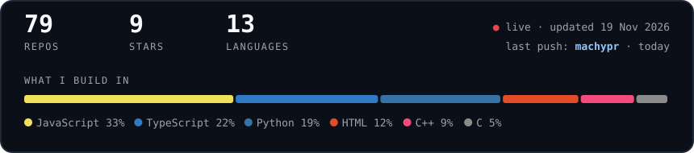

<i>I build things that move: hand-tracked cursed techniques, a macOS-flavoured Hyprland rice, a C fighting game, and the distributed backends underneath it all. 🏆 HackCBS 9.0 winner.</i>

### ⚡ Featured

| Project | What it is | Stack |
|---|---|---|
| **[jjk-open](https://github.com/yadavayush834/jjk-open)** · [▶ play](https://ayushy.me/jjk-open/) | Cast Blue, Red and Hollow Purple with your bare hands through the webcam | MediaPipe · Canvas · Web Workers |
| **[MacHypr](https://github.com/yadavayush834/machypr)** | A macOS-inspired desktop for Arch + Hyprland: native menu bar, smart dock | Hyprland · QML · Python |
| **[Lens](https://github.com/yadavayush834/lens)** | Tells which camera took a photo, even between two phones of the same model, using sensor noise (PRNU) | Python · signal processing |
| **[Spirit Clash](https://github.com/yadavayush834/raylib-fighter)** | Anime-inspired 2D arena fighter with solo AI, local versus and training mode | C17 · raylib |
| **[lil-agent](https://github.com/yadavayush834/lil-agent)** | Offline 1B chat + Hindi/Hinglish voice companion for everyday laptops | TypeScript · local LLM |
| **[Patchwork Studio](https://github.com/yadavayush834/patchwork-studio)** | A browser studio for websites that feel handmade and alive | TypeScript |

### 🛰️ Live from GitHub

**Recently pushed** (auto-updated daily)

<!--RECENT:start-->
- **[jjk-open](https://github.com/yadavayush834/jjk-open)** · today
- **[machypr](https://github.com/yadavayush834/machypr)** — mac os inspired arch hyrland setup · today
- **[yadavayush834.github.io](https://github.com/yadavayush834/yadavayush834.github.io)** · 4 days ago
- **[lens](https://github.com/yadavayush834/lens)** · 4 days ago
- **[timestamp](https://github.com/yadavayush834/timestamp)** · 5 days ago
<!--RECENT:end-->

<picture>
  <source media="(prefers-color-scheme: dark)" srcset="https://raw.githubusercontent.com/yadavayush834/yadavayush834/output/snake-dark.svg" />
  
</picture>

This README rewrites itself every morning via GitHub Actions. <a href="scripts/update_profile.py">See how</a>.
