<div align="center">

<a href="https://github.com/yadavayush834">
  
</a>

<details open>
<summary><b>🕹️ Style 1: 3D ANSI Solid (Default)</b> <i>[ Click to Switch / Collapse ]</i></summary>

```text
 █████╗ ██╗   ██╗██╗   ██╗███████╗██╗  ██╗    ██╗   ██╗ █████╗ ██████╗  █████╗ ██╗   ██╗
██╔══██╗╚██╗ ██╔╝██║   ██║██╔════╝██║  ██║    ╚██╗ ██╔╝██╔══██╗██╔══██╗██╔══██╗██║   ██║
███████║ ╚████╔╝ ██║   ██║███████╗███████║     ╚████╔╝ ███████║██║  ██║███████║██║   ██║
██╔══██║  ╚██╔╝  ██║   ██║╚════██║██╔══██║      ╚██╔╝  ██╔══██║██║  ██║██╔══██║╚██╗ ██╔╝
██║  ██║   ██║   ╚██████╔╝███████║██║  ██║       ██║   ██║  ██║██████╔╝██║  ██║ ╚████╔╝ 
╚═╝  ╚═╝   ╚═╝    ╚═════╝ ╚══════╝╚═╝  ╚═╝       ╚═╝   ╚═╝  ╚═╝╚═════╝ ╚═╝  ╚═╝  ╚═══╝  
```
</details>

<details>
<summary><b>⚡ Style 2: Cyber Slanted Cut</b> <i>[ Click to View ]</i></summary>

```text
   __ _ _   _ _   _ ___ _   _    __   __ _   ____    _   __   __
  / _\ | | | | | | / __| |_| |   \ \ / // \ |  _ \  / \  \ \ / /
 / /_| |_| | |_| | \__ \  _  |    \ V // _ \| | | |/ _ \  \ V / 
/ /_ |___  |___  | |___/ | | |     | |/ ___ \ |_| / ___ \  | |  
\/_/     |_/   |_/ |___/_| |_|     |_/_/   \_\____/_/   \_\|_|  
```
</details>

<details>
<summary><b>📟 Style 3: Classic Terminal Big</b> <i>[ Click to View ]</i></summary>

```text
  ___   __   __ _   _ ____  _   _    __   __    _    ____    _   __   __
 / _ \  \ \ / /| | | / ___|| | | |   \ \ / /   / \  |  _ \  / \  \ \ / /
/ /_\ \  \ V / | | | \___ \| |_| |    \ V /   / _ \ | | | |/ _ \  \ V / 
|  _  |   | |  | |_| |___) |  _  |     | |   / ___ \| |_| / ___ \  | |  
|_| |_|   |_|   \___/|____/|_| |_|     |_|  /_/   \_\____/_/   \_\ |_|  
```
</details>

<details>
<summary><b>💎 Style 4: Minimal Monospace Block</b> <i>[ Click to View ]</i></summary>

```text
┏━┓┓┏┳┳┏━┓┓┏   ┓┏┓━┓┳━┓┏━┓┓┏
┣━┫┗┫┃┃┗━┓┣━┫   ┗┫┣━┫┃ ┃┣━┫┃┃
┛ ┗┗┛┗┛━━┛┛ ┗   ┗┛┛ ┗┻━┛┛ ┗┗┛
```
</details>

<details>
<summary><b>🔥 Style 5: Shadow Gothic</b> <i>[ Click to View ]</i></summary>

```text
 ▄▄▄       ██   ██  █    ██   ██████  ██   ██    ██    ██  ▄▄▄       ██████   ▄▄▄     ██    ██ 
▒████▄     ▒██  ██▒ ██  ██▒▒██    ▒  ▒██  ██▒    ██  ██▒▒████▄     ██▒  ██▒▒████▄   ██    ██ 
▒██  ▀█▄    ▒██ ██░▓██  ██▒░ ▓██▄    ▒██████▒   ▓██  ██▒▒██  ▀█▄  ▒██░  ██▒▒██  ▀█▄ ▓██  █▓░
░██▄▄▄▄██   ░ ▐██▓░▓▓█  ██▌  ▒   ██▒ ▒██  ██▒   ▓▓█  ██▌░██▄▄▄▄██ ▒██   ██░░██▄▄▄▄██ ▒██ █▒░
 ▓█   ▓██▒  ░ ██▒▓░▒▒█████▓ ▒██████▒▒▒██  ██▒   ▒▒█████▓ ▓█   ▓██▒░ ██████▒ ▓█   ▓██▒▒██ █░░
 ▒▒   ▓▒█░   ██▒▒▒ ▒▒▓  ▒   ▒ ▒▓▒ ▒ ░▒▓▒  ▒ ░   ░▒▓▒ ▒ ▒ ▒▒   ▓▒█░░ ▒░▓  ░  ▒▒   ▓▒█░ ▒▀█░  
  ▒   ▒▒ ░ ▓██ ░▒░ ░ ▒░ ▒ ░ ░ ░▒  ░ ░░▒░  ▒ ░   ░░▒░ ░ ░  ▒   ▒▒ ░  ░ ▒ ▒░   ▒   ▒▒ ░ ░ ▐░  
  ░   ▒    ▒ ▒ ░░    ░░ ░ ░ ░  ░  ░  ░░░  ░ ░    ░░░ ░ ░  ░   ▒   ░ ░ ░ ▒    ░   ▒    ░ ░░  
      ░  ░ ░ ░        ░           ░   ░  ░         ░          ░  ░    ░ ░        ░  ░   ░   
```
</details>

<br />

### ⚡ Backend & Applied AI Engineer • Delhi, India

[](https://github.com/yadavayush834)
[](https://leetcode.com/u/ayushwell100)
[](https://www.linkedin.com/in/ayush-yadav-537614265/)
[](https://x.com/sudorunner0)
[](mailto:ayushwell100@gmail.com)

<p align="center">
  <i>Building high-throughput distributed backends, autonomous LLM agents, and semantic search systems.</i>
</p>

---

</div>
